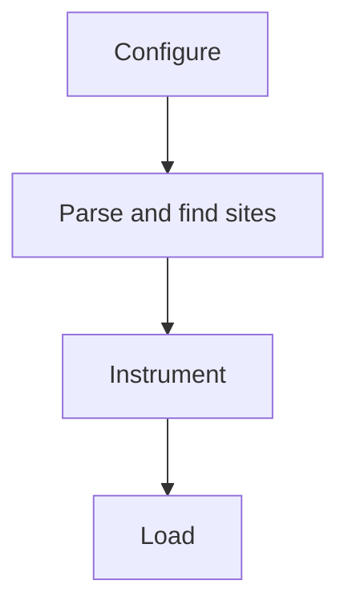
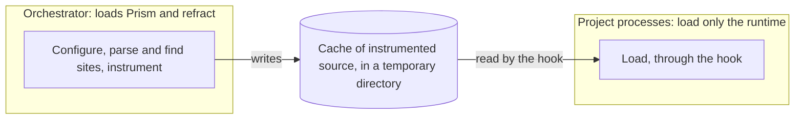
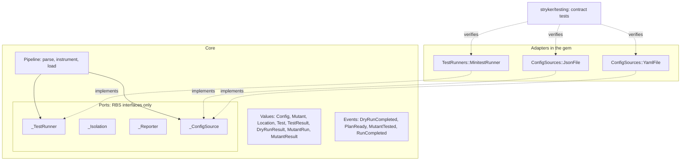

# Architecture

This page explains how **Stryker (for Ruby)** is put together: the pipeline a run goes through, the two kinds of process that run its stages, the ports where it meets test frameworks, processes, configuration files, and reports, and the values and events that pass between the parts. Read it to see where a piece of code belongs and which way dependencies point. The terms are defined in [Loading and isolation](loading-and-isolation.md#terms).

**Stryker (for Ruby)** is a sibling of StrykerJS, Stryker.NET, and Stryker4s, not a plugin of any of them. It shares their concepts, their mutator names, the [mutation testing report schema](https://github.com/stryker-mutator/mutation-testing-elements/tree/master/packages/report-schema), the `mutation-testing-elements` HTML component, and the Stryker dashboard.

## The pipeline

A run goes through these stages, in order. Each stage takes values from the one before it and hands values to the next.



- **Configure.** A config source adapter reads `stryker.config.json` or `stryker.config.yml`, and `Configure.call` merges the file with the command line's options and the defaults, checks every option, and returns one `Config` value. [Configuration](../configuration.md) lists the options, their defaults, and the checks.
- **Parse and find sites.** Prism parses each file, and each mutator walks the tree and returns a `Mutant` for each change it makes: the mutator's name and a text edit on the source ([Mutators](mutators.md) specifies the catalog).
- **Instrument.** The instrumenter produces instrumented source for each file, with every mutant in the file behind a switch, and writes it to a cache outside the project. [Mutant placement](mutant-placement.md) specifies where each switch goes and where each mutant's text comes from. A file with many mutants has the validity checks of its mutants spread over a pool of parse workers ([Parsing plain mutants](loading-and-isolation.md#parsing-plain-mutants)).
- **Load.** In each project process, the loader installs its `load_iseq` hook, and the test runner adapter loads the project's test helper and tests, which load the instrumented code through the hook. [Loading and isolation](loading-and-isolation.md#loading-instrumented-code) specifies the hook.
- **Run each mutant in isolation.** An isolation adapter runs each mutant run in a clean process: a fresh process for a static mutant, on every system. [Loading and isolation](loading-and-isolation.md#isolation) specifies it.

## Two kinds of process

A run has two kinds of process. The orchestrator is the process that `stryker run` starts, and it runs Configure, Parse and find sites, and Instrument. A project process loads the project's code, and it runs Load. [Loading and isolation](loading-and-isolation.md#two-kinds-of-process) specifies both kinds.



Prism and refract load only in the orchestrator, and a project process loads only the runtime, which uses nothing outside the standard library ([ADR 0003](../decisions/0003-the-processes-that-load-the-projects-code-load-only-stryker-for-rubys-runtime-which-depends-on-nothing-outside-the-standard-library.md)).

## Ports and adapters

**Stryker (for Ruby)** follows the ports-and-adapters architecture, also called hexagonal architecture. The core, which is every stage after Configure and the values they pass, holds no code for a particular test framework, operating system, file format, or report format. Where it needs one, it declares a port: an interface named for what the core needs, such as "run these tests". An adapter implements a port for one framework, system, or format. Dependencies point inward: adapters depend on the core, and the core's code never refers to an adapter.



Solid arrows are calls. Dotted arrows show which classes implement a port, and which tests check them.

Adapter names end in a word such as `Runner` or `File` because inside a Stryker namespace, Ruby would resolve `Minitest`, `JSON`, or `YAML` to such an adapter instead of the top-level library.

### The ports

Ruby has no interface keyword, so the ports exist only as RBS interfaces in `sig/`. Ruby checks nothing about them: any object with the right methods works. Steep checks each adapter's method signatures against them, and the contract tests check each adapter's behavior.

```rbs
module Stryker
  type event = Events::DryRunCompleted | Events::PlanReady | Events::MutantTested | Events::RunCompleted

  # Lists and runs the project's tests in one framework.
  interface _TestRunner
    # Loads the project's test helper and test files, and returns every test
    # they define, without running any. Every process that loads the same
    # files gets the same tests, with the same IDs.
    def load_tests: () -> Array[Test]

    # Runs the tests with these IDs, in order, one at a time. Calls
    # observer.test_started before each test and observer.test_finished
    # after it. Stops after the first failing test when bail is true. Raises
    # ArgumentError, before it runs any test, for an ID it doesn't know.
    def run: (Array[String] test_ids, bail: bool, observer: _TestObserver) -> Array[TestResult]
  end

  # Hears when each test starts and finishes. The hit recorder is one.
  interface _TestObserver
    def test_started: (Test test) -> void
    def test_finished: (TestResult result) -> void
  end

  # Runs mutant runs, each in a process that ran no test before it.
  interface _Isolation
    # Starts what the runs need: the loaded parent, or the pool.
    def start: (Config config) -> void

    # Runs every run, up to config.concurrency at a time, and yields each
    # result as it arrives.
    def run_all: (Array[MutantRun] runs) { (MutantResult result) -> void } -> void

    # Ends every process the adapter started.
    def stop: () -> void
  end

  # Receives each domain event of a run, in the order the run publishes them.
  interface _Reporter
    def call: (event event) -> void
  end

  # A value that a JSON document can hold.
  type json_value = String | Integer | Float | bool | nil | Array[json_value] | Hash[String, json_value]

  # Reads options from one kind of configuration file.
  interface _ConfigSource
    # Returns the file's options as nested hashes, keyed by the option names
    # in the file, or nil when the file doesn't exist. Raises ConfigError
    # when the file can't be read or parsed, or holds something other than an
    # object.
    def read: () -> Hash[String, json_value]?
  end
end
```

A port says what the core needs, and nothing about how an adapter does it:

- **`_TestRunner`** lists and runs the project's tests in one framework. Its adapter is `TestRunners::MinitestRunner`, which [Test runners](test-runners.md) specifies.
- **`_Isolation`** runs mutant runs, each in a process that ran no test before it. Its adapter is `Isolation::FreshProcesses`, which [Loading and isolation](loading-and-isolation.md#isolation) specifies.
- **`_Reporter`** receives each domain event of a run.
- **`_ConfigSource`** reads the options of one kind of configuration file. Its adapters are `ConfigSources::JsonFile` and `ConfigSources::YamlFile`, which [Configuration](../configuration.md#the-configuration-file) says how to use.

### Contract tests

`require "stryker/testing"` loads one Minitest module for each of these ports that has an adapter: `Stryker::Testing::TestRunnerContract` and `ConfigSourceContract`. Each holds the tests that every adapter of its port must pass, and the gem's adapters pass them, so an adapter written outside the gem is held to the same behavior. The RBS documentation of [`Stryker::Testing`](../../sig/stryker/testing.rbs) says how to use them.

## Values and events

Every value that passes between stages is a `Data.define` class: immutable and compared by value. Each one's fields are in its RBS documentation, which the table links. The ones that cross a pipe between processes also convert to and from JSON, as [`Stryker::JsonValue`](../../sig/stryker/json_value.rbs) says. A project process loads them, so they use only the standard library ([ADR 0003](../decisions/0003-the-processes-that-load-the-projects-code-load-only-stryker-for-rubys-runtime-which-depends-on-nothing-outside-the-standard-library.md)).

| Value | What it carries |
| - | - |
| [`Config`](../../sig/stryker/config.rbs) | The options of the run, after the file and the command line are merged, from Configure to every stage after it. |
| [`Location`](../../sig/stryker/location.rbs) | The stretch of a file that a mutant changes, as the report schema gives it. |
| [`Mutant`](../../sig/stryker/mutant.rbs) | One change to a file: its ID, its mutator's name, and its text edit, from Parse and find sites to Instrument. |
| [`Test`](../../sig/stryker/test.rbs) | One test of the project, from the test runner adapter to the stages that run tests. |
| [`TestResult`](../../sig/stryker/test_result.rbs) | What happened when one test ran, from the test runner adapter to the stages that judge it. |
| [`DryRunResult`](../../sig/stryker/dry_run_result.rbs) | What a dry run of every test found, which says which tests reach which mutants. |
| [`MutantRun`](../../sig/stryker/mutant_run.rbs) | One run of a chosen set of tests with one mutant active. |
| [`MutantResult`](../../sig/stryker/mutant_result.rbs) | What a run found out about one mutant, in the terms of the report. |

A run publishes domain events, each also a `Data.define` value ([`Stryker::Events`](../../sig/stryker/events.rbs)), and the core hands each event to every reporter:

| Event | Published when |
| - | - |
| `Events::DryRunCompleted` | the dry run passes |
| `Events::PlanReady` | every mutant has a status or a run |
| `Events::MutantTested` | a result is collected |
| `Events::RunCompleted` | the last result is collected |

Stages never call a reporter directly, so adding a reporter changes no stage.

## Where each responsibility lives

| Responsibility | Lives in |
| - | - |
| Reading the configuration file | the config source adapter for its format |
| Merging command-line options and checking every option's name and type | Configure |
| Keeping every path inside the project's root | Configure, for the `mutate` patterns, and every adapter that builds a path |
| Deciding what each mutant changes | the mutator that finds its site |
| Producing instrumented source | the instrumenter |
| Serving instrumented source to Ruby, and checking that every loaded instrumented file came through the hook | the loader |
| Listing tests, running a chosen set, and marking where each test starts and ends | the test runner adapter for its framework ([Test runners](test-runners.md)) |
| Recording which tests reach which mutants | the hit recorder in the Stryker runtime |

## Why this isn't an information system

Domain-driven design's tactical patterns, such as repositories, aggregates, and the unit of work, are for information systems: software that keeps records for a long time, lets many people change them at once, and has to keep each change consistent with the rest. A repository gives the domain a collection of stored records, an aggregate is the boundary inside which a change must stay consistent, and a unit of work makes several changes commit or fail together.

**Stryker (for Ruby)** keeps no records. A run is a batch computation: it reads the source, the tests, and the configuration, computes results, and writes reports once at the end. Nothing it holds outlives the run, and nobody changes its data while it runs. So there is nothing to store and query, no concurrent change to keep consistent, and no transaction to commit, so those three patterns don't apply. What the design takes from domain-driven design is what does apply: a vocabulary shared with the other Stryker ports, immutable values, domain events, and ports at the edges where the outside world varies.

## Related

- [Loading and isolation](loading-and-isolation.md), for the two kinds of process, the cache, and the hook.
- [Mutant placement](mutant-placement.md), for how the instrumenter places each switch.
- [Coverage](coverage.md), for how the switches record which tests reach which mutants.
- [Test runners](test-runners.md), for how each test runner adapter lists and runs a project's tests.
- [ADR 0001](../decisions/0001-mutants-are-compiled-into-the-code-once-and-switched-on-at-run-time.md), for why mutants are compiled into the code once and switched on at run time.
- [ADR 0002](../decisions/0002-every-mutant-runs-in-a-clean-process.md), for why every mutant runs in a clean process.
- [ADR 0003](../decisions/0003-the-processes-that-load-the-projects-code-load-only-stryker-for-rubys-runtime-which-depends-on-nothing-outside-the-standard-library.md), for why the processes that load the project's code load only the runtime.
