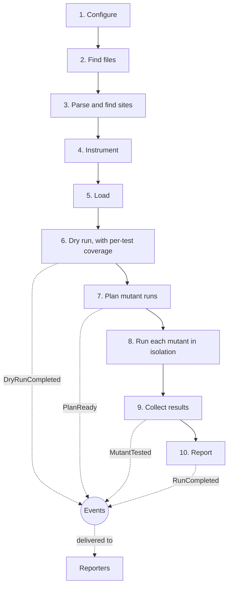
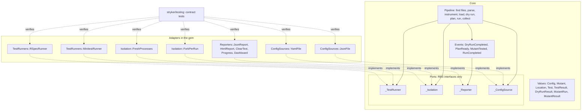

# Architecture

This page explains how **Stryker (for Ruby)** is put together: the pipeline a run goes through, the ports where it meets test frameworks, processes, configuration files, and reports, and the values and events that pass between the parts. Read it to see where a piece of code belongs and which way dependencies point. The terms are defined in [Loading and isolation](loading-and-isolation.md#terms).

**Stryker (for Ruby)** is a sibling of StrykerJS, Stryker.NET, and Stryker4s, not a plugin of any of them. It shares their concepts, their mutator names, the [mutation testing report schema](https://github.com/stryker-mutator/mutation-testing-elements/tree/master/packages/report-schema), the `mutation-testing-elements` HTML component, and the Stryker dashboard. Readers who know StrykerJS will find its stages here under the same names: a dry run, a plan, mutant runs, and reporters.

## The pipeline

A run of `stryker run` goes through ten stages, in order. Each stage takes values from the one before it and hands values to the next.



Solid arrows hand values to the next stage. Dotted arrows show the domain events that stages publish and that reporters receive.

1. **Configure.** A config source reads `stryker.config.json` or `stryker.config.yml`, whose options have StrykerJS's camelCase names ([#3](https://github.com/setdef/stryker_for_ruby/issues/3)). Options from the command line override the file's. The result is one `Config` value.
2. **Find files.** The `mutate` patterns select the files to mutate, relative to the project's root. A path that resolves outside the root is an error.
3. **Parse and find sites.** Prism parses each file. Each mutator walks the tree and returns a `Mutant` for each change it makes, with the mutator's name in the shared naming scheme and the mutant's location in the original source. Every mutant gets an integer ID that is unique in the run.
4. **Instrument.** The instrumenter produces instrumented source for each file, holding every mutant in the file behind a switch.
5. **Load.** The loader installs its `load_iseq` hook, and the test runner adapter loads the project's test helper and tests, which load the instrumented code through the hook. [Loading and isolation](loading-and-isolation.md#loading-instrumented-code) specifies the hook.
6. **Dry run.** Every test runs once with no mutant active, and the switches record which tests reach which mutants. The dry run fails when a test fails, or when an instrumented file loaded without going through the hook. [Coverage](coverage.md) specifies the hits and buckets.
7. **Plan mutant runs.** From the dry run's map, each mutant gets the status `NoCoverage`, a static run, or a runtime run of the tests that reach it, with a time limit taken from the dry-run times of those tests.
8. **Run each mutant in isolation.** An isolation adapter runs each planned run in a clean process: a forked child, a process from the Windows pool, or a fresh process for a static mutant. [Loading and isolation](loading-and-isolation.md#isolation) specifies each.
9. **Collect results.** Each run's outcome becomes a status from the shared schema: `Killed` when a test failed, `Survived` when every test passed, `Timeout` when the run passed its time limit, and `RuntimeError` when the run ended in an error that isn't a test failure.
10. **Report.** When the last result is in, reporters write the results. The JSON reporter writes a report that validates against the shared schema, and the HTML reporter writes a page that shows that report with `mutation-testing-elements`.

## Ports and adapters

**Stryker (for Ruby)** follows the ports-and-adapters architecture, also called hexagonal architecture. The core, which is stages 2 to 9 and the values they pass, holds no code for a particular test framework, operating system, file format, or report format. Where it needs one, it declares a port: an interface named for what the core needs, such as "run these tests". An adapter implements a port for one framework, system, or format. Dependencies point inward: adapters depend on the core, and the core's code never refers to an adapter.



Solid arrows are calls. Dotted arrows show which classes implement a port, and which tests check them.

Adapter names end in a word such as `Runner`, `Report`, or `File` because inside a Stryker namespace, Ruby would resolve `Minitest`, `JSON`, or `YAML` to such an adapter instead of the top-level library.

### The ports

Ruby has no interface keyword, so the ports exist only as RBS interfaces in `sig/`. Ruby checks nothing about them: any object with the right methods works. Steep checks each adapter's method signatures against them, and the contract tests check each adapter's behavior.

```rbs
module Stryker
  type event = Events::DryRunCompleted | Events::PlanReady | Events::MutantTested | Events::RunCompleted

  # Lists and runs the project's tests in one framework.
  interface _TestRunner
    # Loads the project's test helper and test files, and returns every test
    # they define, without running any.
    def load_tests: () -> Array[Test]

    # Runs the tests with these IDs, in order. Calls observer.test_started
    # before each test and observer.test_finished after it. Stops after the
    # first failing test when bail is true.
    def run: (Array[String] test_ids, bail: bool, observer: _TestObserver) -> Array[TestResult]
  end

  # Hears when each test starts and finishes. The hit recorder is one.
  interface _TestObserver
    def test_started: (Test test) -> void
    def test_finished: (TestResult result) -> void
  end

  # Runs mutant runs, each in a process that ran no test before it.
  interface _Isolation
    # Starts what the runs need: the loaded parent, or the pool.
    def start: (Config config) -> void

    # Runs every run, up to config.concurrency at a time, and yields each
    # result as it arrives.
    def run_all: (Array[MutantRun] runs) { (MutantResult result) -> void } -> void

    # Ends every process the adapter started.
    def stop: () -> void
  end

  # Receives each domain event of a run, in the order the run publishes them.
  interface _Reporter
    def call: (event event) -> void
  end

  # Reads options from one kind of configuration file.
  interface _ConfigSource
    # Returns the file's options, keyed by their camelCase names, or nil when
    # the file doesn't exist.
    def read: () -> Hash[String, untyped]?
  end
end
```

A port says what the core needs, and nothing about how an adapter does it:

- **`_TestRunner`** has the Minitest and RSpec adapters ([#5](https://github.com/setdef/stryker_for_ruby/issues/5)). RSpec has a built-in way to stop at the first failure (`--fail-fast`); Minitest 6 has none, so the Minitest adapter supplies one.
- **`_Isolation`** has the fork adapter for Linux and macOS and the fresh-process adapter, which runs the Windows pool and every static run on every system. The orchestrator sends each run to the adapter for its system and its kind of mutant.
- **`_Reporter`** has one adapter per entry in the `reporters` option. A reporter that needs every result, such as the JSON reporter, builds its output when it receives `RunCompleted`. One that shows progress acts on each `MutantTested`.
- **`_ConfigSource`** has one adapter per file format. The YAML adapter reads with `Psych.safe_load`, never `YAML.unsafe_load`, because the file comes from the project.

### Contract tests

`require "stryker/testing"` loads one Minitest module per port: `Stryker::Testing::TestRunnerContract`, `IsolationContract`, `ReporterContract`, and `ConfigSourceContract`. Each holds the tests that every adapter of its port must pass. To test an adapter, include the module in a test class and define the method it calls to build the adapter under test. The gem's adapters pass the same contracts, so an adapter written outside the gem is held to the same behavior.

## Values and events

Every value that passes between stages is a `Data.define` class: immutable, compared by value, and convertible to and from JSON, so that it can cross a pipe between processes.

| Value | What it holds |
| - | - |
| `Config` | Every option of the run, after the file and the command line are merged. |
| `Location` | A start and an end position, each a line and a column, as the report schema defines them. |
| `Mutant` | Its ID, its file, its mutator's name, its location, and its replacement text. |
| `Test` | Its ID in the framework, its name, and its file and location when the framework gives them. |
| `TestResult` | A test, whether it passed, failed, or was skipped, its failure message, and its time. |
| `DryRunResult` | Each test's result and the mutant IDs in its bucket, and the static bucket. |
| `MutantRun` | A mutant, whether it runs as a runtime or a static mutant, the IDs of the tests to run, and the time limit. |
| `MutantResult` | A mutant, its status, the tests that killed it, the tests that covered it, and the run's time. |

A run publishes domain events, each also a `Data.define` value, and the core hands each event to every reporter:

| Event | Published when | It holds |
| - | - | - |
| `Events::DryRunCompleted` | the dry run passes | the `DryRunResult` |
| `Events::PlanReady` | every mutant has a status or a run | the `MutantRun` values, and the mutants that won't run, with their statuses |
| `Events::MutantTested` | a result is collected | the `MutantResult` |
| `Events::RunCompleted` | the last result is collected | every `MutantResult` |

Stages never call a reporter directly, so adding a reporter changes no stage.

## Where each responsibility lives

| Responsibility | Lives in |
| - | - |
| Reading the configuration file | the config source adapter for its format |
| Merging command-line options and checking every option's name and type | Configure |
| Keeping every path inside the project's root | Find files, and every adapter that builds a path |
| Deciding what each mutant changes | the mutator that finds its site |
| Producing instrumented source | the instrumenter |
| Serving instrumented source to Ruby, and checking that every loaded instrumented file came through the hook | the loader |
| Listing tests, running a chosen set, and marking where each test starts and ends | the test runner adapter for its framework |
| Recording which tests reach which mutants | the hit recorder in the Stryker runtime |
| Choosing each mutant's tests, kind of run, and time limit | Plan |
| A clean process for each run, time limits, and killing a run that passes its limit | the isolation adapter |
| Turning a run's outcome into a schema status | Collect results |
| Writing reports, uploading to the dashboard, and showing progress | the reporter adapters |

## Why this isn't an information system

Domain-driven design's tactical patterns, such as repositories, aggregates, and the unit of work, are for information systems: software that keeps records for a long time, lets many people change them at once, and has to keep each change consistent with the rest. A repository gives the domain a collection of stored records, an aggregate is the boundary inside which a change must stay consistent, and a unit of work makes several changes commit or fail together.

**Stryker (for Ruby)** keeps no records. A run is a batch computation: it reads the source, the tests, and the configuration, computes results, and writes reports once at the end. Nothing it holds outlives the run, and nobody changes its data while it runs. So there is nothing to store and query, no concurrent change to keep consistent, and no transaction to commit, so those three patterns don't apply. What the design takes from domain-driven design is what does apply: a vocabulary shared with the other Stryker ports, immutable values, domain events, and ports at the edges where the outside world varies.

## Related

- [Loading and isolation](loading-and-isolation.md), for the hook and the processes each run gets.
- [Coverage](coverage.md), for how the dry run maps tests to mutants.
- [ADR 0002](../decisions/0002-every-mutant-runs-in-a-clean-process.md), for why every mutant runs in a clean process.
